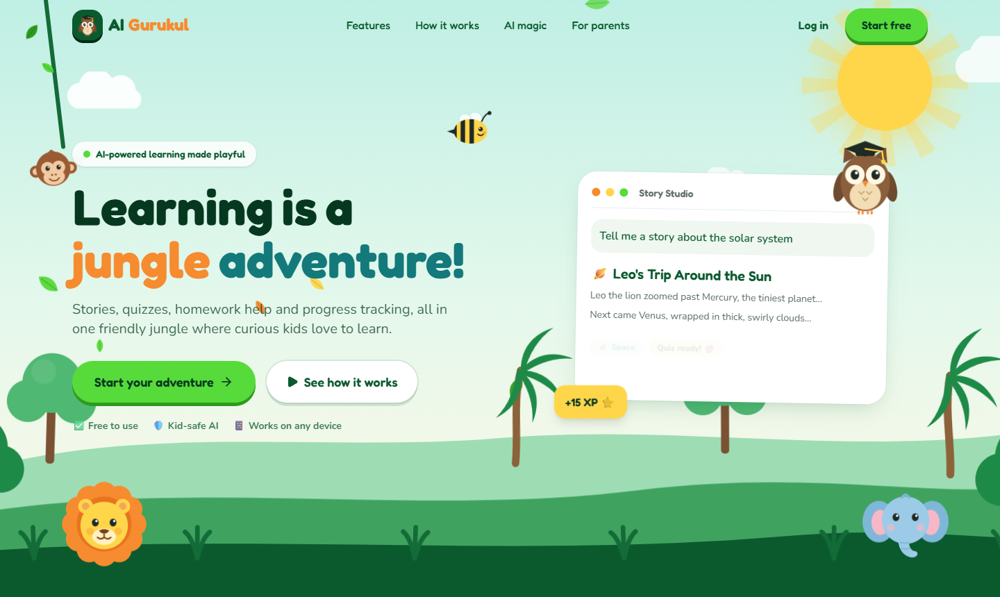
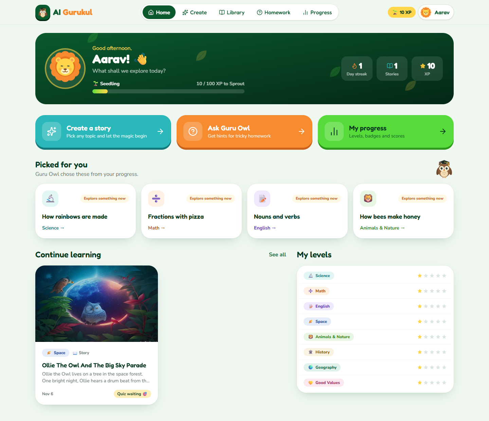
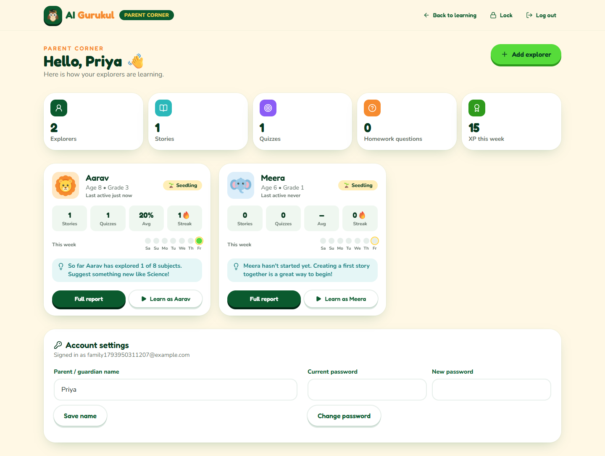
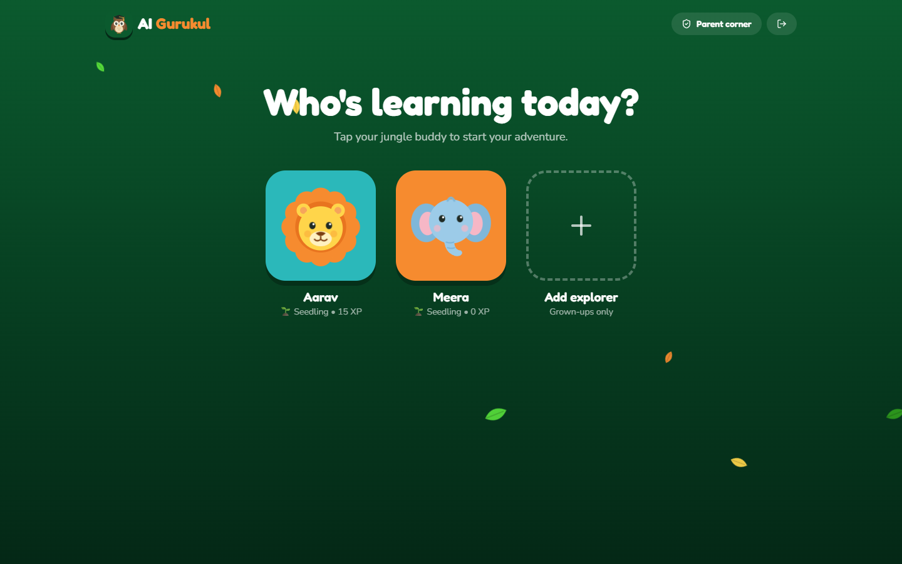
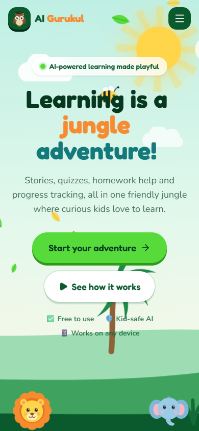
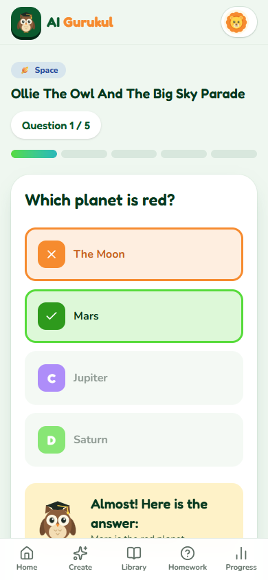

<div align="center">

# 🦉 AI Gurukul

**AI-powered learning made playful.**

A jungle-themed, animated and fully responsive learning website for kids, with AI stories, poems and rhymes, quizzes, learning games, homework help, progress tracking and a Parent Corner for grown-ups.




</div>

---

## 📚 Contents

- [Features](#-features)
- [Screenshots](#-screenshots)
- [Tech stack](#-tech-stack)
- [Getting started](#-getting-started)
- [Free AI: no key needed](#-free-ai-no-key-needed)
- [Configuration](#-configuration)
- [Project structure](#-project-structure)
- [API reference](#-api-reference)
- [Tests](#-tests)
- [Deploying](#-deploying)
- [Author](#-author)

## ✨ Features

| | Feature | What it does |
|---|---|---|
| 📖 | **AI Story Studio** | Type any topic, pick from 8 subjects, and get a story, poem or rhyme written for the child's age and reading level. Includes a "Surprise me" button. |
| 🎨 | **Story reader** | AI illustration, read-aloud with paragraph highlighting, a moral, a fun fact and flip-card vocabulary. |
| 🎯 | **Interactive quizzes** | Instant right/wrong feedback, cheering mascots, confetti, an animated score ring and a review of every answer. |
| 🎮 | **Game Zone** | Five learning games: Memory Match, Word Scramble, Put in Order, Fruit Catch and Monkey Math. Word games are built from each story's own words and text, or from 8 ready-made subject word packs. They run entirely in the browser with no AI or API calls, and earn up to 50 XP a day. |
| 📈 | **Personalized learning** | Each subject has a level from 1 to 5. Scoring 80% or more moves it up, under 50% moves it down, and the next stories and quizzes adapt. |
| 🦉 | **Homework Help** | Chat with Guru Owl in **Hint**, **Steps** or **Explain** mode. Hints come first, so children learn rather than copy. |
| 🏆 | **Progress & rewards** | XP, six jungle ranks, day streaks, subject levels, weekly activity, quiz history and 9 badges. |
| 👨‍👩‍👧 | **Family accounts** | A parent signs up with consent and adds up to 6 children. Each child picks their buddy on the "Who's learning today?" screen. |
| 🛡️ | **Parent Corner** | Locked with the account password. A family overview plus a report per child: written insights, subject levels, quiz scores, games played, activity, the homework questions they asked, stories and badges. |
| 🌴 | **Animated & responsive** | Swaying trees, drifting clouds, falling leaves, a flying bee and original mascots. Phones get a bottom tab bar, and all animations respect the "reduce motion" setting. |
| 🔒 | **Kid safety** | Unsafe topics are blocked before reaching the AI, plus child-safe AI instructions, per-child AI rate limits and signed image links. |

## 📸 Screenshots

<table>
  <tr>
    <td width="50%"><p align="center"><b>Child dashboard</b></p></td>
    <td width="50%"><p align="center"><b>Parent Corner</b></p></td>
  </tr>
  <tr>
    <td width="50%"><p align="center"><b>"Who's learning today?"</b></p></td>
    <td width="50%">
      <p align="center">
        
        &nbsp;
        
      </p>
      <p align="center"><b>On a phone: landing & quiz</b></p>
    </td>
  </tr>
</table>

## 🧰 Tech stack

| Part | Built with |
|---|---|
| **Frontend** | React 19, Vite, Tailwind CSS 4, Motion (animations), React Router, Lucide icons, canvas-confetti |
| **Backend** | Node.js 22.13+, Express 5, SQLite (`node:sqlite`, built into Node), JWT, bcrypt, express-rate-limit |
| **AI** | Pollinations (free, no key) with optional Google Gemini or Groq free keys |
| **Speech & sound** | The browser's built-in Web Speech API for read-aloud, and the Web Audio API for game sound effects |

## 🚀 Getting started

You need **[Node.js](https://nodejs.org) 22.13 or newer** (version 24 recommended) and Git.

```bash
# 1. Get the code
git clone https://github.com/niteshjha-code/ai-gurukul.git
cd ai-gurukul

# 2. Install everything (one time)
npm run setup

# 3. Start the backend  (terminal 1) -> http://localhost:5000
npm run dev:backend

# 4. Start the frontend (terminal 2) -> http://localhost:5173
npm run dev:frontend
```

Open **http://localhost:5173**, click **Start free**, create a family account and make your first story. 🎉

> **Single-server mode:** `npm run build` and then `npm start` serves the website and the API together on http://localhost:5000.

## 🤖 Free AI: no key needed

| What | Service | Key needed? |
|---|---|---|
| Stories, poems, rhymes, quizzes, homework help | [Pollinations](https://pollinations.ai) text API | No |
| Story illustrations | Pollinations image API | No |
| Read-aloud | Browser Web Speech API | No |
| Learning games | Built into the website (no AI) | No |

The keyless Pollinations tier is slow and limited to about **one reply and one image every 45 seconds per IP**. AI Gurukul is built around that limit:

- The quiz is written in the **same AI call** as the story, so opening a quiz is instant.
- Each illustration is downloaded **once**, cached in `backend/data/images/`, and spaced to respect the limit. Mascot artwork shows until it's ready.
- If the AI is busy, the backend waits and retries. If it still fails, a built-in practice story is used, so the app never breaks.

**For faster, better answers, add a free key** in `backend/.env`. The first configured provider is tried first, and Pollinations stays as the backup:

- Google Gemini: https://aistudio.google.com/apikey → `GEMINI_API_KEY=...`
- Groq: https://console.groq.com/keys → `GROQ_API_KEY=...`

## 🔧 Configuration

Copy `backend/.env.example` to `backend/.env`. Every setting is optional for local development.

| Variable | Default | What it does |
|---|---|---|
| `PORT` | `5000` | Backend port |
| `JWT_SECRET` | dev value | Secret for signing logins. **Required** when `NODE_ENV=production` |
| `CORS_ORIGIN` | allow all | Comma-separated list of allowed frontend URLs |
| `GEMINI_API_KEY` / `GEMINI_MODEL` | empty / `gemini-2.5-flash` | Optional free Google Gemini key |
| `GROQ_API_KEY` / `GROQ_MODEL` | empty / `llama-3.3-70b-versatile` | Optional free Groq key |
| `POLLINATIONS_TOKEN` | empty | Optional Pollinations token for higher limits |
| `AI_RATE_LIMIT` | `30` | AI requests allowed per child every 10 minutes |
| `AI_OFFLINE` | `0` | Set to `1` to skip AI calls and use built-in content |

Frontend: set `VITE_API_URL` at build time only if the API is hosted on a different domain.

## 🗂 Project structure

```
ai-gurukul/
├── frontend/                 React app
│   └── src/
│       ├── pages/            Landing, Login, Register, Profiles, Dashboard, StoryStudio,
│       │                     StoryView, Library, Quiz, Games, GamePlay, Homework, Progress, Parent
│       ├── games/            The 5 games, word packs, story-to-game content and sound effects
│       ├── components/       Mascots (SVG), JungleScene, AppLayout, ParentGate, ui ...
│       ├── context/          AuthContext (child + parent sessions)
│       ├── lib/              API client, helpers
│       └── data/             Subjects, topic ideas, fun facts
├── backend/                  Express API
│   ├── src/
│   │   ├── routes/           auth, stories, quizzes, games, homework, parent
│   │   ├── services/         progress (XP, levels, badges), parent reports, profiles, images
│   │   ├── ai/               providers, prompts, kid-safety filter, offline fallback
│   │   ├── db.js             SQLite schema + automatic migrations
│   │   └── app.js            Express app
│   └── test/                 API and migration tests
├── docs/screenshots/
└── package.json              Shortcut scripts for both apps
```

## 🔌 API reference

Every route is under `/api`. "Child" means a child's session token and "Parent" means a parent session token (unlocked with the account password).

| Method | Route | Session | Description |
|---|---|---|---|
| `POST` | `/auth/register` | — | Create a family account and its first child |
| `POST` | `/auth/login` | — | Log in and get a parent session plus the list of children |
| `GET` | `/auth/profiles` | Child or Parent | List the family's children |
| `POST` | `/auth/switch` | Child or Parent | Start learning as one of the children |
| `POST` | `/auth/unlock` | Child or Parent | Re-enter the password to unlock Parent Corner |
| `GET` / `PATCH` | `/auth/me` | Child | Get or edit the current child's profile |
| `POST` | `/stories/generate` | Child | Create an AI story, poem or rhyme (with its quiz) |
| `GET` | `/stories`, `/stories/:id` | Child | List stories / read one |
| `DELETE` | `/stories/:id` | Child | Delete a story |
| `POST` | `/stories/:id/quiz` | Child | Get the quiz for a story |
| `GET` | `/quizzes/:id` | Child | Get the questions (without answers) |
| `POST` | `/quizzes/:id/check` | Child | Check one answer |
| `POST` | `/quizzes/:id/submit` | Child | Submit answers; returns score, XP, level change and badges |
| `GET` | `/games/stats` | Child | Games played, game XP today, best scores and the child's maths level |
| `POST` | `/games/finish` | Child | Save a game result; returns XP (2–10, capped at 50 a day), personal best and badges |
| `POST` | `/homework/ask` | Child | Ask Guru Owl (`hint`, `steps` or `explain` mode) |
| `GET` | `/homework/recent` | Child | Recent homework questions |
| `GET` | `/progress` | Child | XP, rank, streak, levels, badges and recommendations |
| `GET` | `/images/:id?k=...` | Signed link | A story's illustration (`202` until it's ready) |
| `GET` | `/parent/overview` | Parent | Family overview with a card per child |
| `GET` | `/parent/children/:id` | Parent | Full report for one child |
| `POST` / `PATCH` / `DELETE` | `/parent/children[/:id]` | Parent | Add, edit or remove a child |
| `PATCH` | `/parent/account` | Parent | Change the parent's name |
| `POST` | `/parent/password` | Parent | Change the password |
| `GET` | `/health`, `/meta` | — | Server status / subjects and topic ideas |

**Sessions:** a parent session lasts 1 hour and is kept only in the current browser tab. A child session lasts 7 days. Children can switch to a brother's or sister's profile without the password, but adding or removing children and opening Parent Corner need the parent password.

## 🧪 Tests

```bash
npm test          # same as: cd backend && npm test
```

There are 13 tests covering sign-up and login, the kid-safety filter, story → quiz → score → level-up, badges, game results and the daily game XP cap, signed image links, Parent Corner locking, adding/switching/removing children, family privacy, password change, and the automatic database upgrade. They run with AI turned off and an in-memory database.

## 🌍 Deploying

1. Set `NODE_ENV=production` and a long random `JWT_SECRET`.
2. Either run `npm run build && npm start` on one server, **or** host `frontend/dist` separately. In that case, build with `VITE_API_URL=<backend url>` and set `CORS_ORIGIN=<frontend url>` on the backend.
3. Keep `backend/data/` (the SQLite database and cached images) on persistent storage.

## 👤 Author

**Nitesh Kumar** · GitHub [@niteshjha-code](https://github.com/niteshjha-code)

<div align="center">

*Learn • Explore • Enjoy* 🌿

</div>
